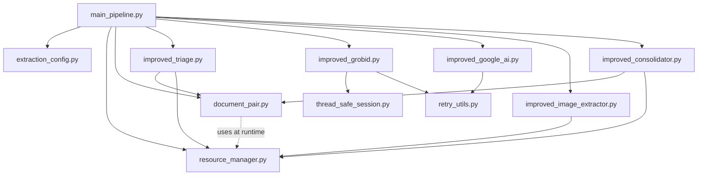

# Architekturübersicht – Scientific PDF Extraction Pipeline v2.0

## 1. Systemkontext

Die Pipeline verarbeitet wissenschaftliche PDF-Publikationen zu strukturierten JSON-Dokumenten. Eingabe sind DOI-Ordner mit je einer `paper.pdf` und einer begleitenden `metadata.json`; beides legt man selbst an, ein Download-Werkzeug gehört nicht zum Repository. Ausgabe ist pro Dokument ein `_extracted.json` mit Metadaten, hierarchischen Sektionen, Tabellen (als Zellmatrix), Figuren (mit extrahierten Bilddateien) und Referenzen.

Die eigentliche Intelligenz liegt in der Kombination dreier unterschiedlicher Extraktionsquellen:

- **Grobid** liefert die logische Dokumentstruktur (TEI/XML): Sektionen, Überschriften, Bibliografie, Koordinaten von Tabellen- und Figurenbereichen
- **Google Document AI** liefert den tatsächlichen Inhalt von Tabellenzellen und OCR-Text für gescannte Dokumente
- **PyMuPDF** liefert die Pixeldaten für Figuren (entweder eingebettete Rasterbilder oder gerenderte Seitenausschnitte)

Grobid weiß *wo* etwas ist, Google AI weiß *was* drinsteht, PyMuPDF extrahiert *das Bild selbst*. Der Consolidator matcht diese drei Sichten anhand von Seitennummern und IDs zu einem Gesamtdokument.

---

## 2. Schichtenarchitektur

Die Module lassen sich in vier Schichten gruppieren, abhängig davon, was sie voraussetzen und wer sie benutzt:

```
┌──────────────────────────────────────────────────────────────┐
│  Schicht 4: Orchestrierung                                   │
│  ┌──────────────────────────────────────────────────────┐    │
│  │  main_pipeline.py — ImprovedExtractionPipeline       │    │
│  └──────────────────────────────────────────────────────┘    │
├──────────────────────────────────────────────────────────────┤
│  Schicht 3: Verarbeitung (domänenspezifisch)                 │
│  ┌────────────┐  ┌────────────┐  ┌────────────┐  ┌────────┐  │
│  │  Triage    │  │  Grobid    │  │ Google AI  │  │ Image  │  │
│  │  (Stufe 1) │  │  (Stufe 2) │  │ (Stufe 3a) │  │ (3b)   │  │
│  └────────────┘  └────────────┘  └────────────┘  └────────┘  │
│                                                               │
│  ┌──────────────────────────────────────────────────────┐    │
│  │  Consolidator (Stufe 4) — datenquellen-übergreifend  │    │
│  └──────────────────────────────────────────────────────┘    │
├──────────────────────────────────────────────────────────────┤
│  Schicht 2: Datenmodell                                      │
│  ┌──────────────────────────────────────────────────────┐    │
│  │  document_pair.py — DocumentPair                     │    │
│  └──────────────────────────────────────────────────────┘    │
├──────────────────────────────────────────────────────────────┤
│  Schicht 1: Infrastruktur (domänenfrei, wiederverwendbar)    │
│  ┌─────────┐ ┌───────────┐ ┌──────────────┐ ┌──────────┐     │
│  │ Config  │ │ Resource  │ │ ThreadSafe   │ │ Retry    │     │
│  │         │ │ Manager   │ │ Session      │ │ Utils    │     │
│  └─────────┘ └───────────┘ └──────────────┘ └──────────┘     │
└──────────────────────────────────────────────────────────────┘
```

Die Pfeile (Abhängigkeiten) zeigen nach unten: Schicht 3 benutzt Schicht 2 und Schicht 1, Schicht 4 benutzt alles. Innerhalb von Schicht 1 gibt es keine Querverbindungen — jedes Infrastruktur-Modul ist eigenständig lauffähig.

### Import-Graph (tatsächliche Python-Imports)



`DocumentPair.validate_pdf_structure()` nimmt einen `ResourceManager` als Parameter, importiert ihn aber nicht — das hält die Schichten sauber getrennt und erlaubt, `DocumentPair` isoliert zu testen.

---

## 3. Schicht 1 – Infrastruktur

### 3.1 `extraction_config.py` – typsichere Konfiguration

Die Konfiguration wird dreistufig aufgelöst: CLI-Argument → Umgebungsvariable `PIPELINE_CONFIG` → Default `config.yaml`. Existiert die Datei nicht, wird sie mit Defaults erzeugt und anschließend gelesen (Self-Bootstrapping).

Die Struktur wird in fünf Dataclasses gemappt:

| Dataclass | Felder | Besonderheit |
|---|---|---|
| `PathConfig` | `pdf_dir`, `metadata_dir`, `output_dir`, `image_dir?`, `progress_db?` | `__post_init__` erzeugt `output_dir` und `image_dir`, leitet optionale Pfade aus `output_dir` ab |
| `GrobidConfig` | `url`, `timeout=300`, `max_retries=3`, `consolidate_citations=True` | URL wird an anderer Stelle per `rstrip('/')` normalisiert |
| `GoogleConfig` | `enabled=False`, `project_id`, `location`, `table_processor_id`, `ocr_processor_id`, `timeout`, `max_retries` | Document AI ist kostenpflichtig und standardmäßig aus (`enabled: false`); die Platzhalter `"your-google-project-id"` und `"<…>"` gelten als "nicht konfiguriert" |
| `PipelineConfig` | `max_workers=4`, `max_memory_mb=2048`, `batch_size=100`, `memory_check_interval=10` | `batch_size` ist deklariert, aber nirgends genutzt |
| `LoggingConfig` | `level="INFO"`, `file="pipeline.log"` | – |

Zusätzlich existiert `Config.get("pipeline.max_workers")` für Dot-Notation-Zugriff auf das rohe Dict — wird aktuell nicht benutzt, ist aber als Escape-Hatch für neue Keys ohne Dataclass-Erweiterung da.

### 3.2 `resource_manager.py` – Memory-Gatekeeper und PDF-Lifecycle

Zwei Aufgaben in einem Modul:

**a) Lifecycle-Management für PyMuPDF-Dokumente.** Jede Stelle, die ein PDF öffnet, benutzt den Context Manager `managed_document(pdf_path)`. Dieser:

1. Prüft vor dem Öffnen die aktuelle Speichernutzung (`_check_memory_usage`)
2. Öffnet das Dokument, erhöht einen thread-sicheren Zähler (`threading.Lock`)
3. Übergibt das `fitz.Document` an den Aufrufer
4. Schließt das Dokument im `finally`-Block — auch bei Exceptions
5. Erzwingt alle `memory_check_interval` Dokumente einen `gc.collect()` und misst erneut

Das eliminiert PyMuPDF-File-Handle-Leaks, die bei Exceptions sonst typisch sind.

**b) Memory-Monitoring.** Via `psutil` wird die RSS-Speichernutzung in MB bei jedem Check gemessen und mit Zeitstempel in `_memory_stats` gesammelt. Überschreitet die Nutzung `max_memory_mb`, wird ein GC erzwungen. Bleibt sie danach immer noch zu hoch, wirft das Modul einen `MemoryError`. Da `MemoryError` von `Exception` erbt, fangen ihn die `try/except`-Blöcke der Stufen ab: Das betroffene Dokument gilt als gescheitert, die Pipeline läuft weiter.

`get_system_info()` liefert zusätzlich CPU- und Disk-Stats für das finale Pipeline-Statistik-Dump.

Die Hilfsklasse `LazyDocumentLoader` existiert als Alternative für Fälle, in denen man ein Dokument länger offen halten will als ein einzelner `with`-Block — sie wird aktuell nirgends benutzt.

### 3.3 `thread_safe_session.py` – per-Thread HTTP-Clients

Der `ThreadSafeSessionManager` nutzt `threading.local()`, um pro Worker-Thread eine eigene `requests.Session` zu halten. Das ist nötig, weil `requests.Session` *nicht* thread-safe ist — das Sharing einer Session zwischen Threads führt zu Connection-Pool-Korruption.

Jede neu erzeugte Session bekommt:

- Einen `urllib3.Retry` mit Status-Codes `[408, 429, 500, 502, 503, 504]` und `backoff_factor=0.3`
- Einen `HTTPAdapter` mit `pool_connections=10`, `pool_maxsize=10`
- Einen benutzerdefinierten User-Agent `"PDF-Extraction-Pipeline/2.0"`

Dieser Retry-Layer ist unabhängig vom `retry_utils.py`-Decorator: `urllib3.Retry` fängt transiente HTTP-Fehler bereits auf Socket-Ebene ab; `retry_utils` läuft eine Ebene darüber und behandelt Exceptions, die durch den HTTP-Retry durchgeschlagen sind.

### 3.4 `retry_utils.py` – Decorator-Factory

Der Hauptdecorator `retry_with_exponential_backoff(max_retries, base_delay, max_delay, backoff_factor, jitter, exceptions)` wird nur dann retry-aktiv, wenn die geworfene Exception im `exceptions`-Tupel liegt. Andere Exceptions werden sofort weitergereicht — das verhindert Retries bei Programmierfehlern.

Delay-Formel: `min(base_delay * backoff_factor^attempt, max_delay) + random(0, 10% jitter)`. Der Jitter verhindert Thundering-Herd-Effekte, wenn mehrere Worker gleichzeitig scheitern und gleichzeitig erneut anfragen würden.

Die Hilfsfunktionen `is_retryable_error()` und `retry_with_callback()` bieten feinere Kontrolle (wird aktuell nicht benutzt — Altlast aus früherer Version).

---

## 4. Schicht 2 – Datenmodell

### 4.1 `document_pair.py` – zentrale Datenträger-Klasse

Ein `DocumentPair` repräsentiert ein PDF zusammen mit seinem Metadaten-JSON und wandert als Einheit durch alle Stufen. Die Klasse ist immutable im Sinne von: sie wird einmal erzeugt und danach nur angereichert.

Felder und ihre Befüllungsphasen:

| Feld | Befüllt in | Zweck |
|---|---|---|
| `pdf_path`, `json_path` | `__init__` | Eingabe |
| `is_valid`, `error_message` | `__post_init__` + `validate_pdf_structure` | Flag für die Triage |
| `file_size_mb` | `__post_init__` | Sortierkriterium für Verarbeitungsreihenfolge |
| `pdf_hash` | `__post_init__` (SHA256, chunkweise) | Deduplizierung, Reproducibility |
| `metadata` | `__post_init__` (lädt `json_path`) | externe Metadaten |
| `page_count` | `validate_pdf_structure` | Performance-Planung |
| `is_scan` | Triage (`AdvancedScanDetector`) | Routing: OCR vs. Grobid |

Die zweistufige Validierung (`__post_init__` → `validate_pdf_structure`) ist bewusst getrennt: Die erste Stufe ist billig (Existenz, Hash, JSON laden), die zweite teuer (PDF öffnen, Seiten zählen, Verschlüsselung prüfen). So kann die Triage zuerst alle Paare instanziieren und erst dann im ThreadPool parallel validieren.

---

## 5. Schicht 3 – Verarbeitungsmodule

### 5.1 `improved_triage.py` – Stufe 1

Das Modul löst zwei separate Probleme:

**Paar-Discovery.** `find_document_pairs()` erkennt automatisch zwei Verzeichnisstrukturen:

- Ordnerbasiert: `pdfs_base/doi_xxx/paper.pdf` + `pdfs_base/doi_xxx/metadata.json`
- Flach: `pdfs/*.pdf` + `metadata/*.json` (Paarung per Dateiname-Stamm)

Die Auto-Erkennung prüft, ob irgendwo `*/paper.pdf` matcht.

**Scan-Klassifikation** via `AdvancedScanDetector`. Statt sich auf ein einzelnes Feature zu verlassen, aggregiert der Detector acht Features aus drei Sample-Seiten (erste, mittlere, letzte) zu einem Score zwischen 0 und 1. Die Gewichtung:

| Feature | Gewicht | Interpretation |
|---|---|---|
| `has_selectable_text == False` | +0.4 | Stärkstes Signal – reiner Scan ohne OCR-Layer |
| `large_image_coverage > 0.7` | +0.3 | Ganzseitige Bilder |
| `avg_text_density < 0.01` | +0.3 | Praktisch kein Text pro Pixel |
| `avg_text_density < 0.05` | +0.2 | Wenig Text (aber vorhanden) |
| `large_image_coverage > 0.4` | +0.2 | Halbseitige Bilder |
| `image_to_page_ratio >= 1.0` | +0.2 | Mindestens ein Bild pro Seite |
| `image_to_page_ratio >= 0.5` | +0.1 | – |
| `uniform_font_size` | +0.1 | OCR-Output hat typisch einheitliche Größen |
| `font_diversity < 0.3` | +0.1 | Wenige unterschiedliche Fonts |
| `text_line_density < 5` | +0.1 | Wenige Zeilen pro Seite |

Schwellwert: `>= 0.6` → Scan. Bei jedem Fehler in der Feature-Extraktion wird der Default `False` (kein Scan) zurückgegeben — konservative Wahl, weil ein fälschlich als nativ behandeltes Scan-PDF die Pipeline nicht abstürzen lässt, nur schlechtere Ergebnisse liefert.

Die Parallelisierung läuft über einen `ThreadPoolExecutor` mit `max_workers` aus der Config. Nach der Triage werden gültige Paare nach `file_size_mb` aufsteigend sortiert — kleine Dokumente zuerst, damit frühe Erfolge Probleme in den Folgestufen schneller sichtbar machen.

### 5.2 `improved_grobid.py` – Stufe 2

Kommuniziert mit einem lokalen Grobid-Server (Default: `http://localhost:8070`). Der entscheidende API-Call ist `POST /api/processFulltextDocument` mit den Parametern:

```
consolidateCitations: 0/1
includeRawCitations: 1
teiCoordinates: 1     ← wichtig: liefert bbox-Koordinaten im TEI
segmentSentences: 1
```

Der Response ist TEI/XML, das mit `lxml` im Recovery-Mode geparst wird (`XMLParser(recover=True)`). Das ist notwendig, weil Grobid gelegentlich leicht fehlerhaftes XML produziert.

**Extraktionsmethoden:**

`_extract_metadata(root)` zieht aus `<teiHeader>`:
- Titel (bevorzugt `<title type="main">`, sonst der erste gefundene Titel)
- Autorenliste (`<author>`)
- Abstract (`<abstract>`)
- Keywords (`<keywords>/<term>`)

`_extract_sections(body)` iteriert `<div>`-Elemente und baut Sektionen mit:
- `title` aus `<head>`
- `paragraphs` aus direkten `<p>`- und `<list>`-Kindern (nicht rekursiv, um verschachtelte Divs als eigene Sektionen zu behalten)
- `level` via `_determine_section_level`: zählt die Tiefe der `<div>`-Verschachtelung (max 6)

Falls keine `<div>`-Struktur gefunden wird — was bei schlecht strukturierten Papern vorkommt —, greift ein Fallback, der alle `<p>`-Elemente aus `<body>` zu einer einzigen "Document Body"-Sektion zusammenfasst.

`_extract_tables(root)` und `_extract_figures(root)` sind symmetrisch aufgebaut: beide suchen `<figure>`-Elemente, die erste Funktion behält nur solche mit `type="table"`, die zweite alle übrigen. Für jedes Element:

- Koordinaten via `_get_coordinates()` aus dem `coords`-Attribut (Format `"page,x1,y1,w,h"`)
- Caption zusammengesetzt aus `<head>` und `<figDesc>`
- Bei Tabellen: XML-Inhalt und Flag `has_structure`, wenn ein `<table>`-Kindelement existiert
- Bei Figuren: `<graphic url>` als externer Bildverweis

**Seiten-Schätzung als Fallback.** Ein wichtiges Detail: Grobid liefert nicht immer Koordinaten. Die Methode `_estimate_page_from_context(element)` nutzt XPath, um alle vorhergehenden `<pb>`-Elemente (Page Breaks) im Dokument zu finden, und entnimmt dem letzten davon das `n`-Attribut als Seitennummer. Fällt auch das aus, wird `1` zurückgegeben. Diese geschätzte Seite landet im Feld `estimated_page`, das der Orchestrator später für koordinatenlose Tabellen und Figuren benutzt.

`_extract_references(root)` findet `<listBibl>` (oder sucht alternativ in Divs mit `type="references"`) und extrahiert jeden `<biblStruct>` mit Volltext, XML-Dump und — falls gefunden — separat den Titel.

Das Modul implementiert das Context-Manager-Protokoll (`__enter__`/`__exit__`), um beim Verlassen die Thread-Sessions sauber zu schließen.

### 5.3 `improved_google_ai.py` – Stufe 3a

Nutzt die Google Cloud Document AI API mit zwei separat konfigurierten Processor-IDs. Das Paket `google-cloud-documentai` steht nicht in `requirements.txt`; ohne es bleibt das Modul importierbar, erst der Prozessor meldet beim Anlegen den fehlenden Import.

- **Table Processor** für Tabellenextraktion auf nativen PDFs
- **OCR Processor** für gescannte PDFs

Die Unterscheidung wird vom Orchestrator getroffen, nicht hier — das Modul bietet beide Methoden an und wählt nicht selbst.

**`extract_table_from_page(pdf_path, page_num)`.** Sendet das komplette PDF an den Table-Processor (eine seitenspezifische API existiert nicht) mit einem `FieldMask(paths=["pages.tables", "text"])`, der die Response auf relevante Felder begrenzt. Aus der Response wird die Zielseite isoliert (DocumentAI ist 0-basiert, die API hier 1-basiert) und durch `_parse_table_result` gejagt.

Das Parsing läuft über `header_rows` und `body_rows` der `documentai.Document.Page.Table`. Für jede Zelle wird:

- Der Text über `_get_text_from_layout` aus den `text_anchor.text_segments` rekonstruiert (die Segmente zeigen mit `start_index`/`end_index` in das Gesamt-`document.text`)
- `col_span` und `row_span` als Integer extrahiert
- Die Konfidenz aus `layout.confidence` übernommen

Das Ergebnis ist pro Tabelle eine Struktur mit `rows` (jede mit `row_type: "header"|"body"`, `cells: [{text, col_span, row_span, confidence, ...}]`), plus aggregierte Felder `row_count`, `col_count`, `has_headers`.

**`process_scanned_pdf(pdf_path)`.** Nutzt den OCR-Processor mit einem breiteren FieldMask (`layout`, `paragraphs`, `lines`, `tokens`, `tables`, `detected_languages`, `blocks`). Die Methode `_extract_page_structure` baut pro Seite:

- Eine Liste von Paragraph-Texten
- Die gemittelte Layout-Konfidenz
- Erkannte Sprachen mit Konfidenzen
- Tabellen, falls auf der Seite vorhanden

Abschließend aggregiert `process_scanned_pdf` über alle Seiten: Gesamt-Konfidenz als Durchschnitt, Sprachen als Dict mit gemittelten Konfidenzwerten pro Sprachcode, Verarbeitungsdauer.

Jede Methode ist mit `@retry_with_exponential_backoff` dekoriert und fängt speziell `ResourceExhausted` (Quota), `DeadlineExceeded` (Timeout), `InvalidArgument` und allgemeine `GoogleAPIError` ab. Quota und Timeout werden propagiert (damit der Retry greift), `InvalidArgument` wird geschluckt (keine Retries bei Programmierfehlern).

### 5.4 `improved_image_extractor.py` – Stufe 3b

Extrahiert Figuren mit einer zweistufigen Strategie. Die Annahme: eingebettete Bilder sind fast immer höher aufgelöst als gerenderte Seitenausschnitte, also versucht der Extractor *zuerst* das eingebettete Bild zu finden und fällt nur bei schlechter Qualität auf Rendering zurück.

**Schritt 1 – Bestes eingebettetes Bild finden (`_find_best_matching_image`).** Iteriert über `page.get_images(full=True)` und berechnet für jedes Bild einen kombinierten Score:

```
score = IoU(img_bbox, target_bbox) * 0.7
      + (intersection_area / target_area) * 0.3
```

Der IoU-Anteil belohnt Bilder, deren Box exakt dem Grobid-Bereich entspricht. Der Coverage-Anteil hilft, wenn das Bild *größer* als der Grobid-Bereich ist (Grobid markiert manchmal nur den Kernbereich). Schwellwert: `score > 0.3`.

**Schritt 2 – Qualitätsbewertung (`_assess_image_quality`).** Der Score wird aus mehreren Faktoren berechnet:

- Pixelzahl: >1 MP +0.3, >0.5 MP +0.2, >0.25 MP +0.1, <0.01 MP −0.2
- Mindestgröße unterschritten (< 50×50 px): −0.3
- Seitenverhältnis: < 3:1 +0.1, > 10:1 −0.1
- Match-Score (von Schritt 1): *0.2
- Pixel-Standardabweichung via PIL: < 5 → −0.3 (Blank-Erkennung), > 50 → +0.1

Akzeptanzschwelle: `quality_score > 0.6`. Unter dieser Schwelle wird auf Rendering zurückgefallen.

**Schritt 3 – Rendering-Fallback (`_render_area`).** Berechnet die Fläche des Ziel-Rechtecks und wählt adaptiv eine DPI-Stufe:

- Fläche > 50.000 px² → Matrix 2×2 (≈144 DPI)
- Fläche > 10.000 px² → Matrix 3×3 (≈216 DPI)
- sonst → Matrix 4×4 (≈288 DPI)

Kleine Ausschnitte werden also höher aufgelöst gerendert, damit Details sichtbar bleiben.

**Datenformate der Ausgabe.** Das Modul gibt eines von zwei Dicts zurück:

```python
# Raw-Variante (Bild-Bytes in Memory)
{"type": "raw", "format": "png", "data": b"...", "width": ..., "height": ...,
 "dpi": ..., "quality_score": ..., "size_mb": ...}

# Rendered-Variante (Pfad, Datei bereits geschrieben)
{"type": "rendered", "format": "png", "path": "/output/images/.../fig_1.png",
 "width": ..., "height": ..., "dpi": ..., "quality_score": 0.8, "size_mb": ...}
```

Der Consolidator behandelt beide Varianten unterschiedlich (siehe 5.5).

`extract_all_images_from_page` ist ein separater Einstiegspunkt, der *alle* Bilder einer Seite ohne Bbox-Matching liefert — genutzt vom Page-basierten Figure-Fallback des Orchestrators.

### 5.5 `improved_consolidator.py` – Stufe 4

Dieser Schritt ist reine Datenfusion ohne weitere externe Calls. Er nimmt:

- `DocumentPair` (mit Original-Metadaten)
- `grobid_data` (Struktur, Tabellen-Metadaten, Figuren-Metadaten, Referenzen)
- `table_extractions: Dict[page_num → List[tables]]` von Google AI
- `figure_extractions: Dict[fig_id → image_dict]` vom ImageExtractor
- optional `ocr_data` bei Scans

und produziert ein einziges JSON-Dokument mit fester Schema-Struktur:

```
{
  "document_id": "doi_xxx_...",
  "metadata": {
    "original_metadata": {...},
    "file_info": {pdf_path, file_size_mb, page_count, is_scan, document_hash},
    "processing_info": {extraction_timestamp, pipeline_version, extraction_methods: [...]},
    "document_metadata": {...}           // aus Grobid-teiHeader
  },
  "content": {
    "sections": [...],
    "tables": [...],
    "figures": [...],
    "references": [...]
  },
  "statistics": {total_*, quality_metrics: {...}, extraction_success}
}
```

**`_enhance_sections(sections)`.** Erweitert jede Grobid-Sektion um stabile IDs (`section_N`), Element-IDs (`section_N_elem_M`), und berechnet Textstatistiken auf zwei Ebenen: pro Element und aggregiert pro Sektion. Die Textstatistik zählt Wörter (Whitespace-Split), Zeichen (ohne Spaces) und Sätze (Heuristik über `.!?`, mindestens 1).

**`_integrate_tables(grobid_tables, extracted_tables)`.** Matching-Strategie: Für jede Grobid-Tabelle wird die Seite aus `coordinates.page` gelesen. Dann wird aus `extracted_tables[page_num]` die *erste* verfügbare Tabelle genommen und an das Grobid-Metadaten-Gerüst angefügt. Tabellen, die Google AI auf Seiten findet, zu denen Grobid keine Tabelle hat, werden als `extraction_method: "google_documentai_only"` zusätzlich angehängt. Der Code dokumentiert explizit, dass Bbox-basiertes Matching als Verbesserung aussteht (Kommentar "TODO: Implement better matching based on position").

**`_integrate_figures(grobid_figures, extracted_figures, doc_name)`.** Behandelt die zwei Ausgabeformate des ImageExtractors unterschiedlich:

- `type == "rendered"`: Pfad wird relativ zum `output_dir` gemacht
- `type == "raw"`: Die Bytes aus `data` werden via `_save_raw_image` als PNG unter `output/images/{doc_name}/{fig_id}.png` geschrieben

In beiden Fällen landet ein `image`-Sub-Objekt mit Dimensionen, DPI, Qualitäts-Score und Pfad in der Figur.

**`_structure_ocr_content(ocr_data, grobid_data)`.** Bei Scans wird der OCR-Output seitenweise in Sektionen verpackt (`title: "Page N"`, `type: "ocr_page"`). Der Code erwähnt im Kommentar, dass eine Ausrichtung an der Grobid-Struktur wünschenswert wäre, ist aber nicht implementiert.

**Qualitäts-Metriken am Ende:**

```python
successful_table_extractions / total_tables  → table_extraction_rate
successful_figure_extractions / total_figures → figure_extraction_rate
ocr_confidence (bei Scans)
```

Diese Metriken fließen sowohl ins einzelne Dokument als auch in den `extraction_summary_report.json` über alle Dokumente.

---

## 6. Schicht 4 – Orchestrierung

### `main_pipeline.py` – `ImprovedExtractionPipeline`

Die Klasse besteht aus zwei Hauptmethoden: `run()` als äußere Schleife über alle Dokumente und `_process_single_document()` als innere Pipeline für ein einzelnes PDF.

**Initialisierung.** Im `__init__` werden in dieser Reihenfolge aufgebaut:

1. `Config` laden (triggert ggf. Default-Erzeugung)
2. Logging konfigurieren (file + console mit unterschiedlichen Formattern)
3. `ResourceManager` erzeugen
4. Triage, Grobid, ImageExtractor, Consolidator erzeugen (reihen sie die Abhängigkeiten: `config`, teilweise `resource_manager`)
5. `GoogleDocumentAIProcessor` *nur* wenn `_is_google_configured()` — prüft, dass `google.enabled` gesetzt ist, `project_id` kein Platzhalter ist und `GOOGLE_APPLICATION_CREDENTIALS` gesetzt ist

Ohne Google-Konfiguration läuft die Pipeline trotzdem, liefert aber nur Grobid-Output (keine Tabellen, keine OCR).

**Innere Pipeline (`_process_single_document`).** Das Result-Dict wird mitgeschrieben und enthält:

- `success`: bool
- `document_id`, `pdf_path`
- `stages_completed: List[str]` — eine der Werte `"grobid"`, `"ocr"`, `"table_extraction"`, `"figure_extraction"`, `"consolidation"`, `"save"`
- `warnings: List[str]` — pro nicht-kritischem Fehler ein Eintrag
- `error: Optional[str]` — nur wenn komplett gescheitert
- `processing_time`, `statistics`

Jede Stufe ist in einen eigenen try/except gewickelt: Grobid-Fehler verhindert nicht die Figure-Extraktion, eine gescheiterte Einzeltabelle verhindert nicht die restlichen Tabellen. Das ist die zentrale Resilienz-Eigenschaft — Teilergebnisse werden gerettet statt verworfen.

**Fallback-Kaskade bei Tabellen (native PDFs):**

```
grobid_data["tables"] ≠ []
    │
    ├─ Tabellen mit coordinates.page vorhanden?
    │      JA → Verwende diese Seiten
    │      NEIN ↓
    ├─ Tabellen mit estimated_page vorhanden?
    │      JA → Verwende diese (Logged als "estimated")
    │      NEIN ↓
    ├─ PDF öffnen, erste min(total_pages, 10) Seiten scannen
    │      Exception → Fallback: {1, 2, 3}
    │
    └─ Für jede so bestimmte Seite: Google AI Table-Extraction
```

Die Aggressivität ist bewusst: Lieber einmal zu viel Google AI anrufen als eine vorhandene Tabelle verpassen.

**Fallback-Kaskade bei Figuren:**

```
Für jede Figur aus grobid_data["figures"]:
    │
    ├─ Hat bbox?
    │      JA → image_extractor.extract_figure(bbox)
    │           (intern: raw → rendering-Fallback)
    │      NEIN ↓
    ├─ Hat estimated_page?
    │      JA → image_extractor.extract_all_images_from_page()
    │           → nimm das flächenmäßig größte Bild
    │      NEIN → skip (zählt als figures_skipped)
```

**Äußere Pipeline (`run`).** Stufe 1 (Triage) läuft synchron über `triage_system.process_batch(max_workers)`. Das Ergebnis sind zwei Listen; die validen werden optional via `--limit` beschnitten. Dann startet ein zweiter `ThreadPoolExecutor` mit `max_workers` Threads, der `_process_single_document` für jedes Paar aufruft. Ergebnisse werden via `as_completed` eingesammelt, Progress-Bar per `tqdm`.

Alle 10 fertiggestellten Dokumente wird die Memory-Statistik nachgeführt (`pipeline_stats["memory_stats"]`). Am Ende werden geschrieben:

1. `pipeline_stats.json` — Ausführungsmetadaten + alle Einzel-Results
2. `extraction_summary_report.json` — Aggregat über alle erfolgreichen Dokumente

Die Exit-Codes folgen einem einfachen Schema:

| Code | Bedeutung |
|---|---|
| 0 | Alle Dokumente erfolgreich |
| 1 | Teilerfolg (mindestens eins erfolgreich, mindestens eins gescheitert) |
| 2 | Alle gescheitert, aber Initialisierung ok |
| 3 | Pipeline-Initialisierung gescheitert |
| 130 | Benutzerabbruch (Ctrl+C) |

---

## 7. Threading-Modell

Zwei parallele Ausführungsebenen, die sich *nicht* überlappen:

```
┌─────────────────────────────────────────────────────────┐
│ Main-Thread                                             │
│                                                         │
│  1. Config/Init                                         │
│  2. Triage startet ThreadPoolExecutor (N Threads)       │
│     └─ N Threads validieren DocumentPairs parallel      │
│     └─ Alle Threads beendet                             │
│  3. Processing startet ThreadPoolExecutor (N Threads)   │
│     └─ N Threads verarbeiten je ein Dokument parallel   │
│     └─ Jeder Thread: Grobid → Google AI → Image → Cons. │
│     └─ Alle Threads beendet                             │
│  4. Reports schreiben                                   │
└─────────────────────────────────────────────────────────┘
```

**Shared State zwischen Threads:**

| Komponente | Thread-Safety-Mechanismus |
|---|---|
| `ResourceManager._document_counter` | `threading.Lock` |
| `ResourceManager._memory_stats` | Ohne Lock — Race Conditions beim Append möglich, aber nicht kritisch |
| `ThreadSafeSessionManager` | `threading.local()` pro Thread |
| `GrobidProcessor.session_manager` | Intern per-Thread-Session |
| `GoogleDocumentAIProcessor.client` | Google-Client ist laut Docs thread-safe |
| File I/O (Output) | Jedes Dokument schreibt nur in eigene Dateien (Name = doc_id) |

Die Worker-Threads in beiden Pools sind benannt (`TriageWorker`, `ProcessorWorker`), was im File-Logging die Zuordnung erleichtert.

---

## 8. Fehlerbehandlung – drei Ebenen

```
Ebene 1: urllib3.Retry (in ThreadSafeSessionManager)
   │ fängt: HTTP 408/429/5xx, Connection-Reset
   │ Wirkung: transparent, kein Exception im Python-Code
   │
   ▼ falls durchgebrochen
Ebene 2: @retry_with_exponential_backoff (in Grobid, GoogleAI)
   │ fängt: requests.RequestException, google.api_core.GoogleAPIError
   │ Wirkung: max_retries Versuche mit Backoff
   │
   ▼ falls durchgebrochen
Ebene 3: try/except pro Stufe (in _process_single_document)
   │ fängt: jede Exception
   │ Wirkung: Eintrag in warnings[], Stufe als fehlgeschlagen markiert,
   │         nächste Stufe läuft trotzdem
```

Auch ein `MemoryError` aus dem `ResourceManager` landet auf Ebene 3 (er erbt von `Exception`): Die Pipeline bricht nicht ab, sondern markiert das Dokument als gescheitert und arbeitet weiter.

---

## 9. Datenfluss – Ein Dokument von Anfang bis Ende

```
┌─────────────────────────────────────────────────────────────┐
│ Triage (Main-Thread, parallel über TriagePool)              │
│                                                             │
│  pdfs_base/doi_xxx/                                         │
│    ├─ paper.pdf      ─┐                                     │
│    └─ metadata.json  ─┤                                     │
│                       ▼                                     │
│  DocumentPair(is_valid=True, is_scan=False, pages=12,       │
│               file_size_mb=3.4, pdf_hash="abc...")          │
└─────────────────────────────────────────────────────────────┘
                        │
                        ▼ (ProcessorPool nimmt Pair auf)
┌─────────────────────────────────────────────────────────────┐
│ Stufe 2 – Grobid                                            │
│                                                             │
│  POST /api/processFulltextDocument                          │
│  → TEI/XML Response                                         │
│                                                             │
│  {metadata: {title, authors, abstract, keywords},           │
│   sections: [{id, title, paragraphs, level}, ...],          │
│   tables: [{id, caption, coordinates, content_xml}, ...],   │
│   figures: [{id, caption, coordinates, graphic_ref}, ...],  │
│   references: [{id, text, xml, title}, ...]}                │
└─────────────────────────────────────────────────────────────┘
                        │
                        ▼
┌─────────────────────────────────────────────────────────────┐
│ Stufe 3a – Google AI (pro Tabellenseite, parallel nicht)    │
│                                                             │
│  Für jede page_num ∈ Tabellenseiten:                        │
│    process_document(field_mask=["pages.tables", "text"])    │
│    → filtered_document[target_page]                         │
│    → parse_table_result()                                   │
│                                                             │
│  {page_num: [{rows: [{row_type, cells: [...]}],             │
│               confidence, row_count, col_count}]}           │
└─────────────────────────────────────────────────────────────┘
                        │
                        ▼
┌─────────────────────────────────────────────────────────────┐
│ Stufe 3b – ImageExtractor (pro Figur)                       │
│                                                             │
│  Für jede Figur mit bbox:                                   │
│    find_best_matching_image()  → Score > 0.3?               │
│      JA → _extract_raw_image()                              │
│           Quality > 0.6? → type: "raw", data: bytes         │
│           Quality ≤ 0.6 → Rendering-Fallback                │
│      NEIN → _render_area() → type: "rendered", path: "..."  │
│                                                             │
│  {fig_id: {type, format, data/path, width, height,          │
│            dpi, quality_score, size_mb}}                    │
└─────────────────────────────────────────────────────────────┘
                        │
                        ▼
┌─────────────────────────────────────────────────────────────┐
│ Stufe 4 – Consolidator                                      │
│                                                             │
│  _enhance_sections()    → IDs + Textstatistiken             │
│  _integrate_tables()    → Grobid-Meta + Google-Inhalt       │
│  _integrate_figures()   → Grobid-Meta + Bild (save if raw)  │
│  Statistics-Aggregation → quality_metrics                   │
│                                                             │
│  {document_id, metadata, content, statistics}               │
│                                                             │
│  save_consolidated_document()                               │
│  → output/doi_xxx_extracted.json                            │
└─────────────────────────────────────────────────────────────┘
```

---

## 10. Konfigurations-Wiring

Welche Config-Werte landen wo:

| Config-Pfad | Verwendet in |
|---|---|
| `paths.pdf_dir` / `paths.metadata_dir` | `ImprovedDocumentTriageSystem.__init__` |
| `paths.output_dir` | Consolidator, ImageExtractor, Pipeline-Stats |
| `paths.image_dir` | Consolidator, ImageExtractor |
| `paths.progress_db` | Deklariert, aber unbenutzt |
| `grobid.url` | `ImprovedGrobidProcessor.__init__` (mit `rstrip('/')`) |
| `grobid.timeout` / `max_retries` | An `ThreadSafeSessionManager` weitergegeben |
| `grobid.consolidate_citations` | Als POST-Parameter pro Request |
| `google.enabled` | `_is_google_configured()` (Standard `false`: keine Aufrufe an Google) |
| `google.project_id` / `location` / `*_processor_id` | `ImprovedGoogleDocumentAIProcessor.__init__` |
| `google.timeout` / `max_retries` | Als Request-Parameter + Retry-Decorator |
| `pipeline.max_workers` | Triage-Pool + Processor-Pool (beide!) |
| `pipeline.max_memory_mb` / `memory_check_interval` | `ResourceManager.__init__` |
| `pipeline.batch_size` | Deklariert, unbenutzt |
| `pipeline.enable_retry` | Deklariert, unbenutzt (Retry ist immer aktiv) |
| `logging.level` / `logging.file` | `_setup_logging()` (legt den Ordner der Logdatei bei Bedarf an) |

---

## 11. Bekannte Einschränkungen und Entwurfsartefakte

**Ungenutzte Config-Felder.** `progress_db`, `batch_size` und `enable_retry` existieren im Schema, werden aber nicht gelesen. Das `progress_db`-Feld deutet auf einen geplanten, aber nie implementierten Checkpoint-Mechanismus hin — aktuell gibt es kein Resume nach Abbruch.

**Tabellen-Matching nur per Seite.** `_integrate_tables` matcht Grobid und Google AI ausschließlich über die Seitennummer und nimmt die erste Tabelle pro Seite. Bei mehreren Tabellen auf einer Seite kann das zu Vertauschungen führen. Der TODO-Kommentar im Code schlägt Bbox-Overlap-Matching vor.

**OCR-Alignment fehlt.** Wenn ein Scan-PDF zusätzlich Grobid-Struktur liefert (ungewöhnlich, aber möglich), wird diese Struktur ignoriert und der OCR-Text seitenweise als eigene Sektionen abgelegt.

**Doppelter Retry-Layer.** `urllib3.Retry` und `@retry_with_exponential_backoff` arbeiten übereinander. Bei einem HTTP-500 kann das theoretisch zu `3 × 3 = 9` Versuchen führen. In der Praxis unkritisch, aber wert zu wissen.

**`max_workers` wird zweimal verbraucht.** Der gleiche Config-Wert steuert Triage-Pool und Processor-Pool. Da beide sequenziell laufen, ist das kein Ressourcenkonflikt — aber wer einen Wert für die teurere Phase wählen will, muss einen Kompromiss eingehen.

**Keine Wiederaufnahme.** Ein Abbruch (z.B. `KeyboardInterrupt`) verliert den Fortschritt aller laufenden Worker. Bereits gespeicherte `_extracted.json`-Dateien bleiben, der Code prüft aber beim nächsten Start nicht, ob ein Dokument bereits verarbeitet wurde.

**`LazyDocumentLoader` tot.** Die Hilfsklasse in `resource_manager.py` ist im Produktivcode nicht referenziert.

**`retry_utils`-Extras tot.** `retry_on_failure`, `retry_with_callback`, `is_retryable_error` und die beiden Exception-Klassen sind deklariert, aber nicht aktiv genutzt.
